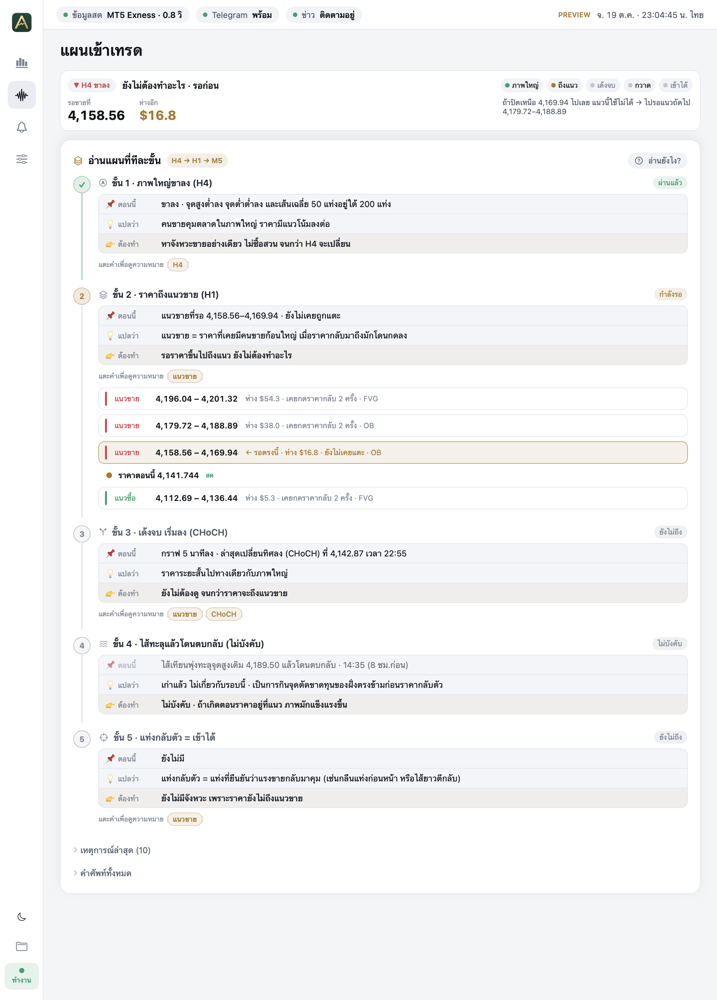
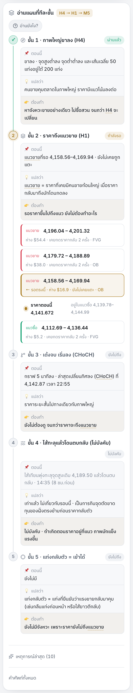
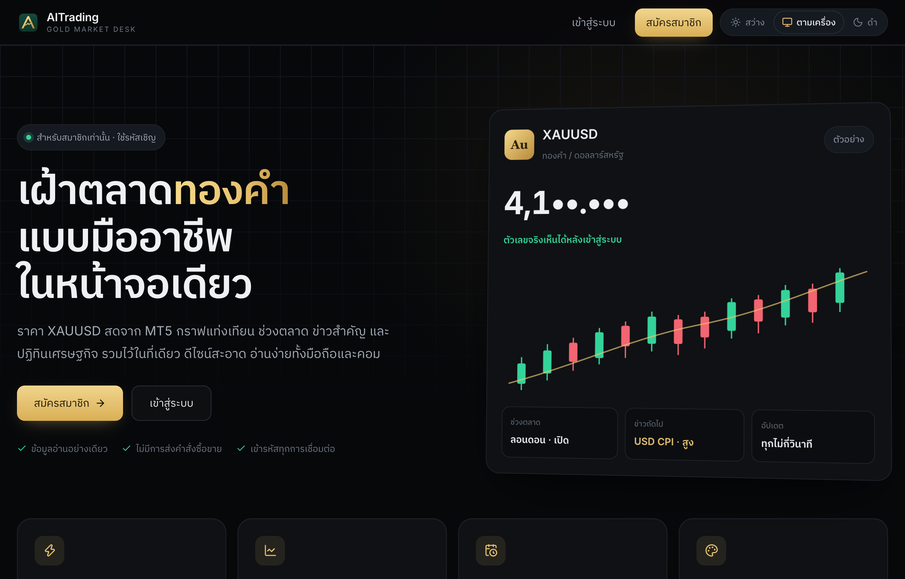
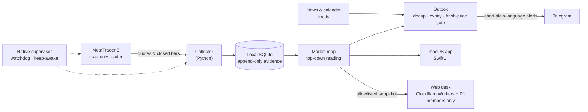

  

  
  
  
  
  

  <b>A personal trading desk for spot gold (XAUUSD).</b> 
  It watches the market around the clock, draws its reading straight onto the chart, 
  and explains every step in plain language. <b>The trader always makes the call and presses the button.</b>

ระบบเฝ้าตลาดทองคำส่วนตัว · อ่านตลาดทีละขั้นเป็นภาษาคน · คนตัดสินใจและกดออร์เดอร์เองทุกครั้ง

  <a href="#-market-map">Market map</a> ·
  <a href="#️-macos-app">macOS app</a> ·
  <a href="#-web-desk">Web desk</a> ·
  <a href="#️-architecture">Architecture</a> ·
  <a href="#-tech-stack">Tech stack</a>

---

## ✨ Highlights

| Feature | What it does |
|---|---|
| 🧭 **Market map** | A top-down reading of the market: big-picture direction, the zones worth waiting for, and the short-term turn — in five clear steps. |
| 📖 **Explained for beginners** | Every step says *what is on the chart now*, *what it means* and *what to do next*. Tap any term (OB, FVG, CHoCH…) to see what it means. |
| 📈 **Drawn on the chart** | Zones, structure breaks and sweeps are drawn on the live candles, with the distance to the next level updated in real time. |
| ⚡ **Real-time** | Prices stream from MetaTrader 5 to the Mac app in ~0.25 s and to the web desk within a few seconds. |
| 🪞 **One layout, two screens** | The macOS app and the web desk read top to bottom in the same order and share one design system with Light · System · Black themes. |
| 🔐 **Members-only web** | Invite-only sign-up, hashed passwords and secure sessions; market data is only served to signed-in members. |
| 🛡️ **Safe by design** | Read-only market access. No order-execution API, no automatic trading, no alerts on stale data. |

## 🧭 Market map

  

The desk reads the market from the top down and shows where it stands as five steps:

| Step | Question it answers |
|---|---|
| **1 · Big picture** | Which side is in control on the higher timeframe? |
| **2 · The zone** | Where is the next area worth waiting for, and has price returned to it? |
| **3 · The turn** | Has the short-term structure turned back in the big-picture direction? |
| **4 · The sweep** *(optional)* | Did price grab liquidity beyond an old high or low and get rejected? |
| **5 · The candle** | Is there a confirming candle — and where would the idea be wrong? |

Each step comes with three short lines — 📌 **now**, 💡 **meaning**, 👉 **what to do** — and a status light
(passed · waiting · optional). A short card above the chart always answers one question first:
*“What should I do right now?”* — usually, *wait*.

<table>
  <tr>
    <td width="62%"></td>
    <td width="38%"></td>
  </tr>
  <tr>
    <td align="center">Step by step with tap-to-explain terms · macOS, light theme</td>
    <td align="center">The same steps on a phone</td>
  </tr>
</table>

> The map is a reading aid, not a promise. Its entry step is tracked against randomised baselines and is
> treated as narration until the evidence says otherwise.

## 🖥️ macOS app

<table>
  <tr>
    <td width="50%"></td>
    <td width="50%"></td>
  </tr>
  <tr>
    <td align="center">Light theme</td>
    <td align="center">Service status and data health</td>
  </tr>
</table>

A native SwiftUI app that also runs the background service: it supervises the data collector,
keeps the Mac awake during market hours, restarts a hung terminal, and raises an owner-only alert
when anything looks wrong.

## 🌐 Web desk

  

  

A responsive desk at **[gold.jerngub.com](https://gold.jerngub.com)** for invited members: live price and daily range,
the market map drawn on a 24 / 48 / 96-bar chart, the five steps, market sessions, news and the economic calendar.
Only an explicit allowlist of fields ever leaves the Mac, and every snapshot is validated before it is shown.

## 🏗️ Architecture

**Principles**

- **Human in the loop** — the system reads and explains, the trader decides. There is deliberately no path from a signal to an order.
- **No signal on bad data** — stale quotes, data gaps or a forming candle block new alerts.
- **Evidence first** — each event is stored at the moment it happens and never edited afterwards; ideas are tested against random baselines before they are trusted.
- **Secrets stay local** — tokens and ids live only in ignored local files, never in Git.

## 🧰 Tech stack

| Layer | Technology |
|---|---|
| Market data | MetaTrader 5 (MQL5 reader) on macOS |
| Engine & services | Python 3, SQLite, launchd |
| Desktop | Swift, SwiftUI, AppKit (native chart renderer) |
| Web | React, TypeScript, Cloudflare Workers, D1 |
| Messaging | Telegram Bot API |
| Quality | ~965 Python tests, native self-tests, 65 web tests |

## 🔒 About the source

This repository is a **showcase**. The full source code, the analysis rules and all trading data
are kept in a **private** repository.

---

⚠️ For personal research and monitoring only. Nothing here is financial advice, a recommendation to trade,
or a promise of profit. Trading gold carries a high risk of loss. 
© 2026 Chayutarat Srioumsuk (mcsmajor) · All rights reserved.

