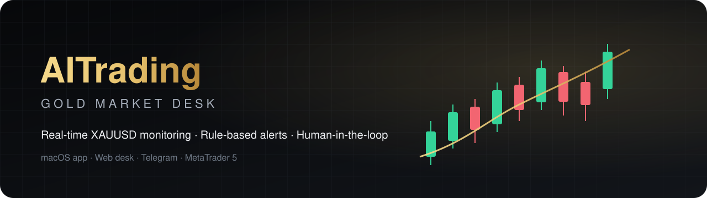
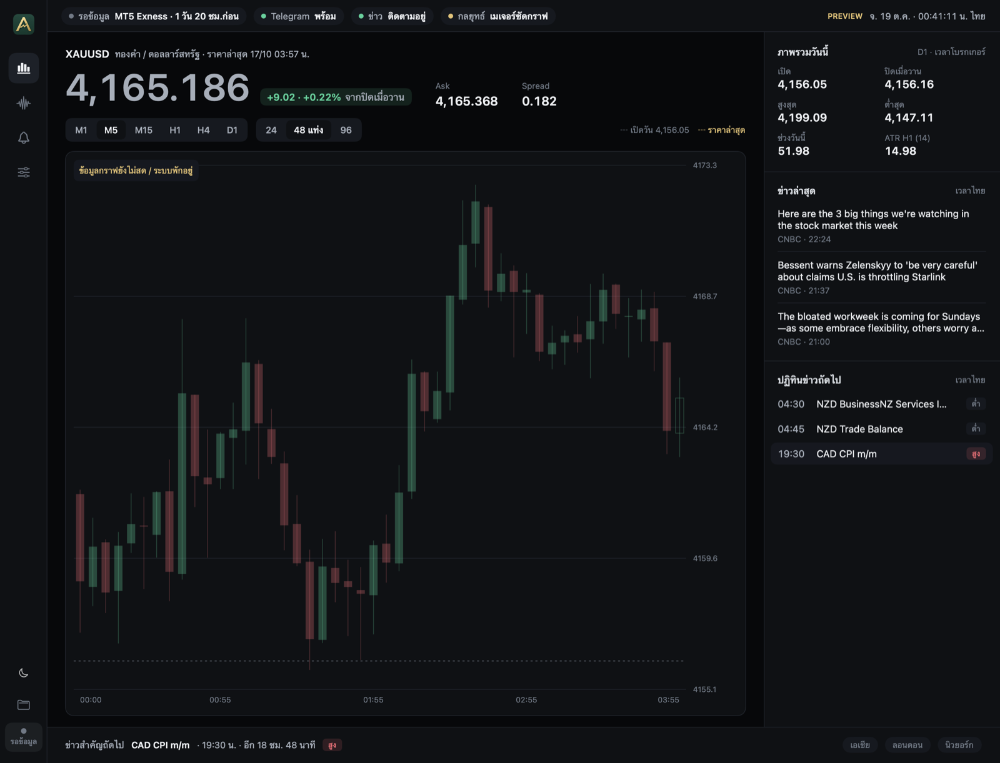
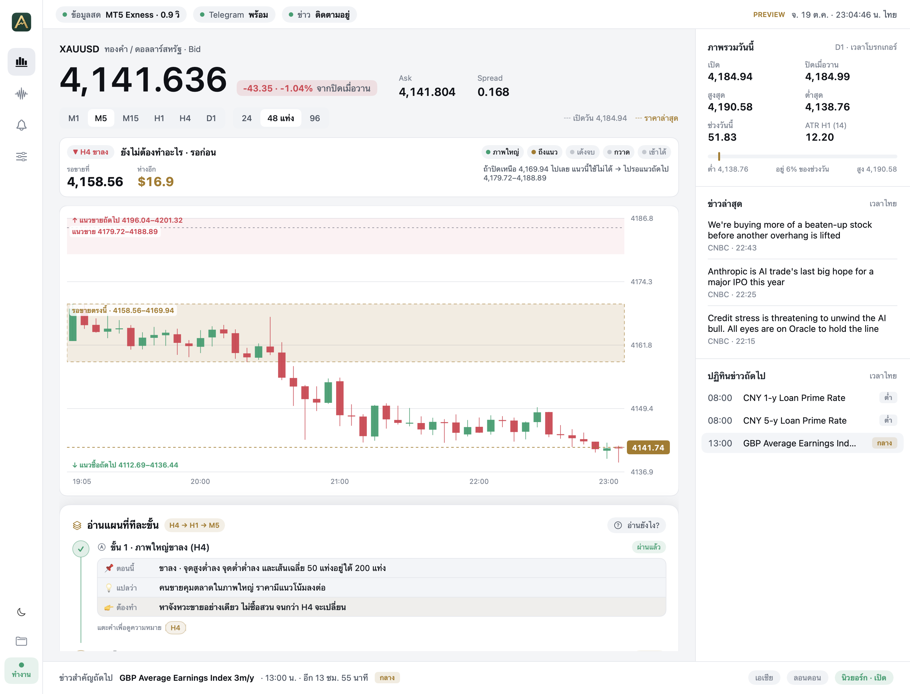
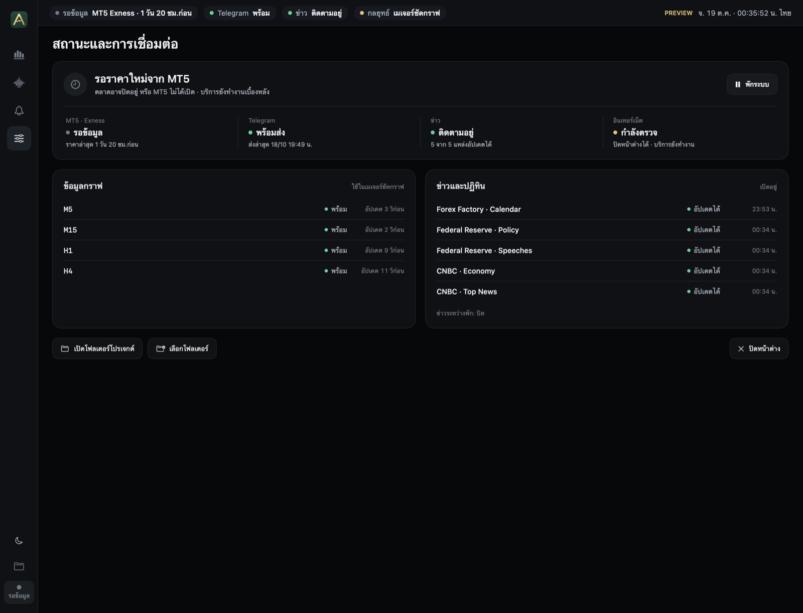
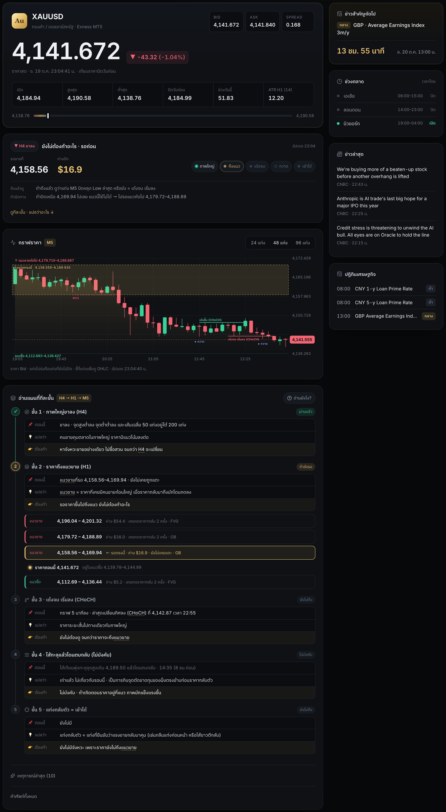
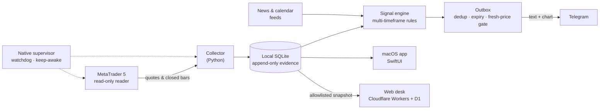

  

  
  
  
  

  <b>A personal trading desk for spot gold (XAUUSD).</b> 
  It watches the market around the clock, explains what it sees in plain language, 
  and sends an alert with a chart when a setup is complete. <b>The human always presses the button.</b>

ระบบเฝ้าตลาดทองคำส่วนตัว · แจ้งเตือนพร้อมกราฟ · คนตัดสินใจและกดออร์เดอร์เองทุกครั้ง

---

## ✨ Highlights

| Feature | What it does |
|---|---|
| ⚡ **Real-time** | Prices stream from MetaTrader 5 to the Mac app in ~0.25 s and to the web desk within a few seconds. |
| 🧭 **Multi-timeframe engine** | A rule-based signal engine reads closed candles across timeframes and raises a staged alert only when every condition is met. |
| 🖼️ **Alerts with a picture** | Each Telegram alert carries a freshly drawn chart, so the setup can be judged in one glance. |
| 🛡️ **Safe by design** | Read-only market access. No order-execution API, no automatic trading, no stale-data alerts. |
| 🧾 **Honest record keeping** | Every signal is frozen at the moment it is issued and stored append-only, never edited afterwards. |
| 🌗 **Light · System · Black** | The macOS app and the web desk share one design system and three themes. |

## 🖥️ macOS app

  

<table>
  <tr>
    <td width="50%"></td>
    <td width="50%"></td>
  </tr>
  <tr>
    <td align="center">Light theme</td>
    <td align="center">Service status and data health</td>
  </tr>
</table>

A native SwiftUI app that also runs the background service: it supervises the data collector,
keeps the Mac awake during market hours, restarts a hung terminal, and raises an owner-only alert
when anything looks wrong.

## 🌐 Web desk

  

A read-only, responsive desk at **[gold.jerngub.com](https://gold.jerngub.com)**: live price, daily range,
market sessions, the next high-impact event, a candle chart (24 / 48 / 96 bars) and an optional entry sound.
Only an explicit allowlist of fields ever leaves the Mac, and every snapshot is validated before it is shown.

## 🏗️ Architecture

**Principles**

- **Human in the loop** — the system proposes, the trader decides. There is deliberately no path from a signal to an order.
- **No signal on bad data** — stale quotes, data gaps, wide spreads or a forming candle block new alerts.
- **Evidence first** — each alert stores its inputs at issue time; outcomes are tracked separately from real trades, and unknown stays unknown.
- **Secrets stay local** — tokens and ids live only in ignored local files, never in Git.

## 🧰 Tech stack

| Layer | Technology |
|---|---|
| Market data | MetaTrader 5 (MQL5 reader) on macOS |
| Engine & services | Python 3, SQLite, launchd |
| Desktop | Swift, SwiftUI, AppKit (native chart renderer) |
| Web | React, TypeScript, Cloudflare Workers, D1 |
| Messaging | Telegram Bot API |
| Quality | ~940 automated Python tests, native self-tests, web tests |

## 🔒 About the source

This repository is a **showcase**. The full source code, the signal rules and all trading data
are kept in a **private** repository.

---

⚠️ For personal research and monitoring only. Nothing here is financial advice, a recommendation to trade,
or a promise of profit. Trading gold carries a high risk of loss. 
© 2026 mcsmajor · All rights reserved.

